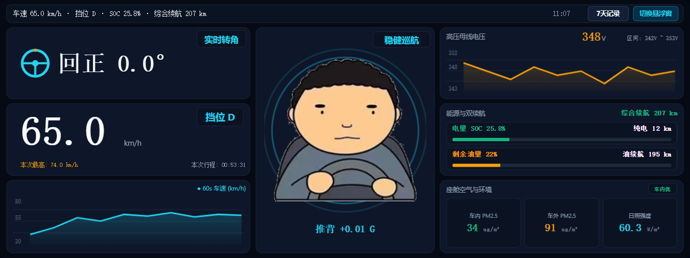
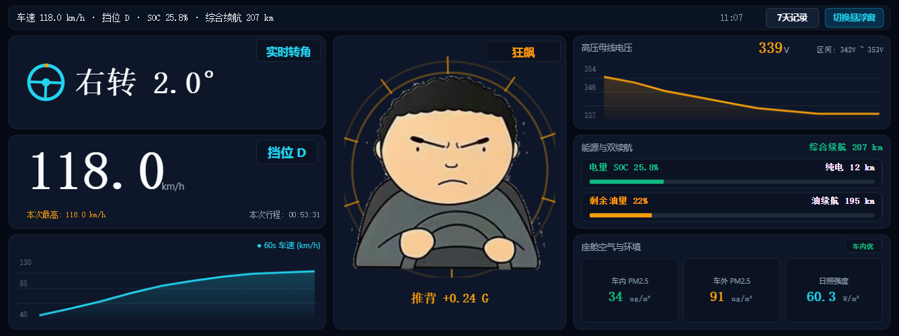
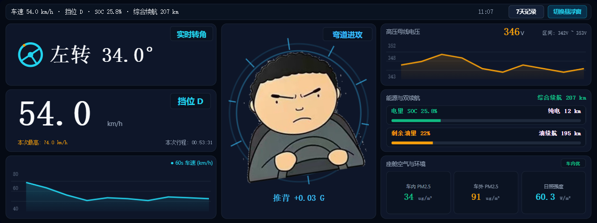
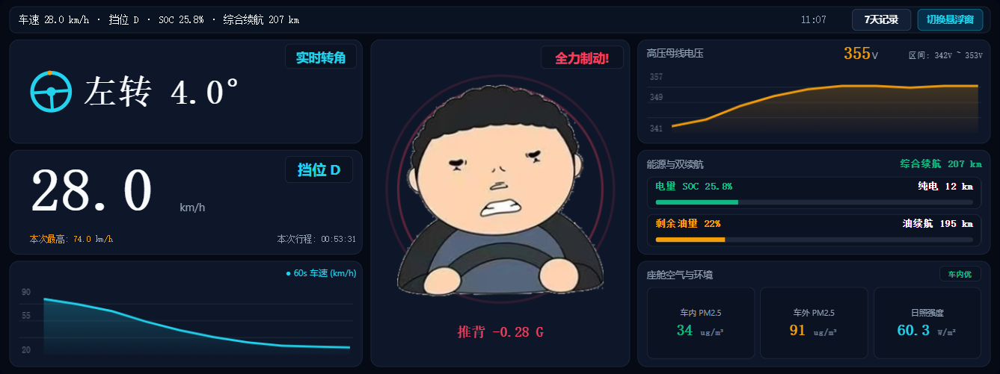

# LanDian-E5Dash

一款专为 **蓝电 E5 一代旗舰（`DFSK-S508L`）** 车机打造的轻量化原生 Android 实时车况仪表看板（`E5Dash.apk` / 包名 `com.bw.cardashboard`）。

> **适配与实车验证说明**
> - 本项目**仅在「蓝电 E5 一代旗舰（`DFSK-S508L`，Android 9，1920×720 横屏，240 dpi）」车机完成实车验证**。
> - 依赖车机系统框架提供的只读车辆属性服务（`BwCarProxy`），其他车型或不同车机硬件平台未经验证，可能无法读取车况数据或存在界面比例差异。

---

## 界面预览

### 稳健巡航（主界面）


### 多驾驶状态联动
| 狂飙加速 (`+G`) | 弯道进攻（大转角） | 全力制动 (`-G`) |
| :---: | :---: | :---: |
|  |  |  |

---

## 核心特性

1. **实时驾驶与动态视觉**
   - **真实纵向 G 值**：基于车速（`PERF_VEHICLE_SPEED`）时间微分平滑计算，实时显示加速推背（`+G`）与制动减速度（`-G`）。
   - **方向盘实时转角**：校准物理方向盘正反方向与回正零点，联动中心表情状态机（`稳健巡航` / `狂飙` / `弯道进攻` / `全力制动!`），自带防抖迟滞与呼吸/速度线动画。
   - **高对比度车速与挡位**：`62sp` 主车速显示、本次行程计时与最高车速记录。

2. **独立 60s 双波形监测**
   - **60s 车速波形（青色）**：独立自适应量程（10 km/h 步进），清晰展示加减速曲线。
   - **60s 高压母线电压波形（橙色）**：独立自适应量程（最小 6V 跨度），实时观察高压母线电压波动与本次区间（`min ~ max`）。

3. **能源双续航与座舱环境**
   - **双续航条**：电量 `SOC %` + 纯电续航、剩余油量 `%` + 燃油续航、综合续航汇总。
   - **座舱空气与环境**：车内 PM2.5（`ug/m³`）、车外 PM2.5（`ug/m³`）、日照强度（`W/m²`）及空气质量徽章。

4. **极简悬浮窗 & 7 天行车记录**
   - **极简悬浮窗**：可自由拖动，仅保留 **转角 | G 值 | 母线电压** 三项核心高频数据，方便在导航/CarPlay 界面旁置查看。
   - **7 天 CSV 自动记录**：数据写入 `/sdcard/Download/CarDashboard/YYYY-MM-DD.csv`；内置 P 挡驻车 5 秒节流 + 每 10 条内存批量落盘（退出/切后台自动刷盘），大幅降低车机闪存写入压力，并提供最近 7 天统计弹窗。

5. **极致轻量化与代码保护**
   - 纯原生 Android Java + `Canvas` 自绘实现，无重型第三方依赖，Release APK 仅约 **271 KB**。
   - 启用 `javac -g:none`、`R8` 激进混淆与反射字符串混淆。

---

## 安装与权限说明（车友直接下载用）

1. 前往本仓库 **Releases** 下载最新版 `E5Dash.apk`。
2. 通过 U 盘文件管理器或 ADB 安装到车机：
   ```bash
   adb install -r E5Dash.apk
   ```
3. 首次使用建议授予以下权限：
   - **悬浮窗权限**（显示在其他应用上层）：用于开启右上角「切换悬浮窗」。
   - **存储权限**：用于读写 `/sdcard/Download/CarDashboard/` 下的 7 天行车记录 CSV。

---

## 源码构建

本项目支持使用 Android SDK Build-Tools + `R8` 直接通过 PowerShell 脚本编译打包（无需完整 Android Studio 工程导入）：

1. 配置 `build_apk.ps1` 中的本地 Android SDK / JDK / 签名证书路径（请使用自己的签名证书，仓库不包含任何 keystore）。
2. 在项目根目录执行：
   ```powershell
   .\build_apk.ps1
   ```
3. 构建完成后将在 `out/` 目录生成混淆并签名的安装包。

---

## 合规与免责声明

- **仅限只读状态展示**：本项目仅在运行时通过标准反射读取车机系统框架暴露的只读车辆属性，**不写入任何 CAN 总线控制指令、不篡改任何车辆或里程数据**。
- **不含厂商专有文件**：本仓库**不包含**任何车机厂商的专有二进制文件、系统框架 `.jar`、`.so` 动态库或固件文件。
- **素材与用途声明**：项目内部分动画演示图片仅作个人非商业学习演示使用；本项目基于 [MIT License](LICENSE) 开源，仅供个人学习与技术交流，**请勿用于任何商业用途**。
- **行车安全提醒**：驾驶过程中请以原车仪表盘与实际路况为准，**切勿在行驶中分心操作或长时间注视中控屏幕**；因使用或修改本软件产生的任何直接或间接风险由使用者自行承担。
